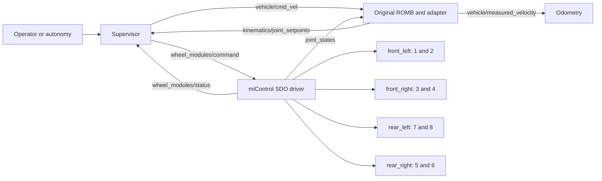

# Four-module source graph

This diagram describes source connections, not a live ROS capture. The approved
obsolete partial-layout diagrams and their generators have been removed.

All four modules and eight joints are required. Existing operator, battery,
scanner and safety inputs retain their current paths. See the
[four-module setup](four_module_setup.md).
